# PharmaBox

Manuale utente completo

**Dall’accesso al primo inventario, fino all’esportazione e alla gestione dell’account.**

Edizione 15 ottobre 2026 · Versione di riferimento 1.0.4+34

## 1. Come usare questo manuale

PharmaBox aiuta a censire i prodotti della farmacia: organizza il lavoro in liste, cerca i prodotti per nome o codice, registra le quantità e prepara file PDF o CSV da conservare o condividere.

Questa guida segue le funzioni presenti nella versione di riferimento. I nomi dei pulsanti sono riportati in **grassetto**. “Toccare” significa premere brevemente sullo schermo; “scorrere” significa trascinare un dito nella direzione indicata.

Gli screenshot sono acquisizioni dell’app in esecuzione su un emulatore Android, con le liste di prova presenti nell’ambiente. Nomi, quantità e risultati illustrano le procedure: non sono un inventario da utilizzare. L’aspetto delle finestre di sistema può cambiare su un altro telefono. Le immagini mostrano una build di sviluppo: l’icona arancione del simulatore non compare nella versione di rilascio.

Per iniziare subito, leggere i capitoli 2–6 e seguire l’esercitazione del capitolo 14. Per uno scanner esterno, consultare anche il capitolo 9; per scadenze e lotti letti dal DataMatrix, i capitoli 9 e 10. Per un problema specifico, passare al capitolo 22.

### Che cosa serve

- L’app installata sul telefono e un indirizzo email a cui si può accedere.
- Una connessione Internet per registrazione, accesso, ricerca nel catalogo, informazioni dei prodotti e aggiornamento dell’abbonamento.
- Per le letture automatiche: uno scanner Bluetooth compatibile, carico e acceso, Bluetooth attivo sul telefono e abbonamento riconosciuto dall’app. Per leggere scadenza e lotto dal DataMatrix serve uno scanner **2D**: i lettori laser 1D leggono solo il bollino e l’EAN.
- Per condividere un’esportazione: un’app o una destinazione di salvataggio disponibile sul dispositivo.

L’app lavora in verticale. Su un telefono piccolo, scorrere per raggiungere tutti i contenuti. Non è necessario uno scanner per iniziare a cercare e inserire prodotti manualmente.

### I tre concetti fondamentali

| Termine | Significato pratico |
| --- | --- |
| Lista | Un insieme di prodotti, per esempio “Banco destra” o “Inventario ottobre”. |
| Prodotto | Una specifica referenza identificata dal codice, con la relativa quantità. |
| Pezzi | Il numero di confezioni conteggiate. Tre prodotti con quantità 2, 5 e 1 corrispondono a 8 pezzi. |
| Lotto e scadenza | Dati letti dal DataMatrix della confezione: i pezzi di uno stesso prodotto possono appartenere a lotti con scadenze diverse. |

## 2. Primo avvio e orientamento

Aprire PharmaBox. La schermata iniziale propone **Email**, **Password**, **Ricorda credenziali**, **Accedi**, **Password dimenticata?** e **Crea nuovo account**.

Se si dispone già di un account, passare al capitolo 4. Se è il primo utilizzo, toccare **Crea nuovo account**. Evitare di creare un secondo account per ritrovare le liste: le liste sono associate all’account con cui sono state create.

La freccia in alto a sinistra torna normalmente alla schermata precedente. Prima di uscire da una finestra di modifica, usare **Salva**, **Crea** o **Conferma** quando si desidera applicare la modifica; **Annulla** o **Chiudi** interrompono l’operazione.

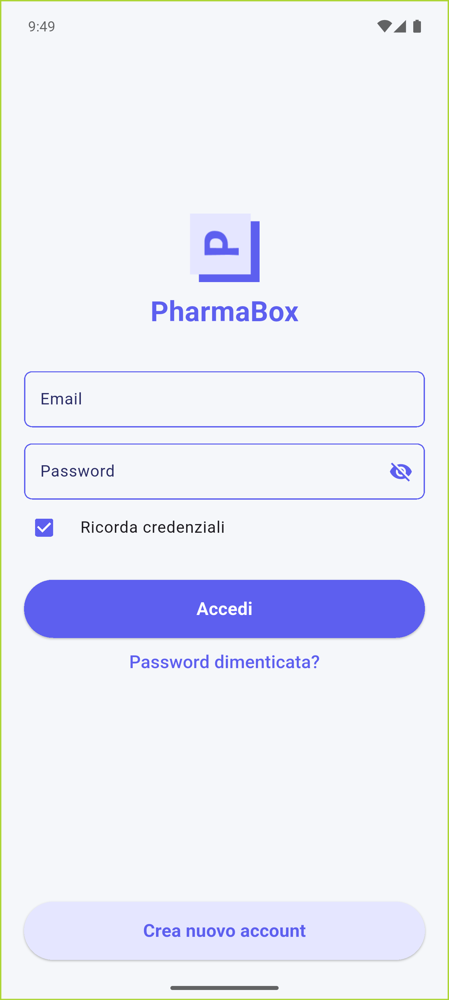

## 3. Creare un account e verificare l’email

1. Dalla schermata iniziale toccare **Crea nuovo account**.
2. Inserire il proprio indirizzo **Email**, controllando eventuali errori di battitura.
3. Inserire una **Password** di almeno 8 caratteri, con una lettera maiuscola, una minuscola, un numero e un carattere speciale. Per esempio, il simbolo `!` è accettato.
4. Ripetere la stessa password in **Conferma password**. L’icona a forma di occhio consente di verificarla visivamente.
5. Controllare gli indicatori sotto i campi: devono essere soddisfatti tutti i requisiti. Se compare **Le password non coincidono**, correggere uno dei due campi.
6. Toccare **Crea account** quando il pulsante è disponibile.
7. Leggere il messaggio **Verifica la tua email**, aprire la propria casella di posta e seguire il collegamento ricevuto.
8. Tornare al login e accedere con le credenziali appena create.

Il pulsante di creazione può essere disabilitato mentre la password è incompleta o la conferma non coincide. Una email già registrata richiede l’accesso all’account esistente oppure il recupero della password.

Se l’email di verifica non arriva, controllare spam e posta indesiderata. Un tentativo di accesso con email non verificata può inviare un nuovo collegamento. Se vengono segnalate troppe richieste, attendere prima di riprovare.

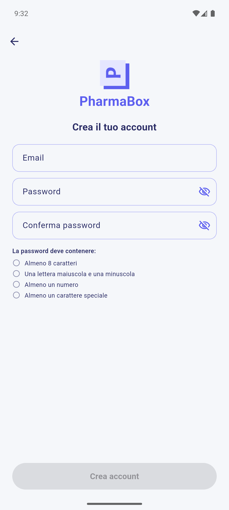

## 4. Accedere e recuperare la password

### Accesso ordinario

1. Inserire **Email** e **Password**.
2. Se il telefono è destinato al proprio uso, scegliere se attivare **Ricorda credenziali**.
3. Toccare **Accedi** e attendere l’apertura delle liste.

**Ricorda credenziali** ripropone i dati nei campi ai successivi avvii; non sostituisce il pulsante **Accedi**. L’icona a forma di occhio mostra o nasconde la password. Su un telefono condiviso, valutare se lasciare memorizzate le credenziali.

Se compare un errore di autenticazione, verificare l’indirizzo, la password e la connessione. Un account appena creato deve avere l’email verificata.

### Password dimenticata

1. Toccare **Password dimenticata?** nella schermata iniziale.
2. Inserire l’email associata all’account.
3. Toccare **Invia** una sola volta e controllare la posta.
4. Seguire le istruzioni nell’email per scegliere una nuova password.
5. Tornare a PharmaBox ed eseguire l’accesso con la nuova password.

La schermata può parlare di “codice di verifica”; il recupero effettivo avviene seguendo l’email di reimpostazione. Il messaggio di invio è generico e non conferma che l’indirizzo sia registrato. Se non arriva nulla, verificare indirizzo e spam prima di ripetere la richiesta.

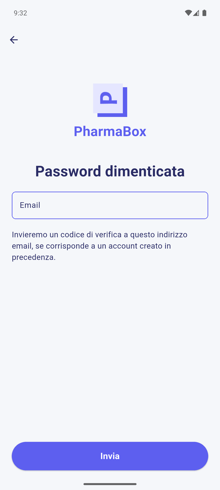

## 5. Comprendere la schermata delle liste

Dopo l’accesso, la schermata principale mostra le liste dell’account. Ogni riga contiene una casella di selezione, il nome e il totale dei pezzi della lista.

| Elemento | Che cosa fa |
| --- | --- |
| Crea una lista / pulsante + | Apre la finestra per creare una lista. |
| Nome della lista | Apre i prodotti e la ricerca per quella lista. |
| Casella a sinistra | Seleziona la lista da esportare. Non apre la lista. |
| Numero a destra | Indica i pezzi complessivi della lista, non il numero di referenze diverse. |
| Totale pezzi in tutte le liste | Somma le quantità di tutte le liste visualizzate, anche se non sono selezionate. |
| Scarica liste selezionate | Prepara l’esportazione delle liste spuntate. |
| Menu in alto a destra | Apre informazioni, opzioni del telefono, abbonamento, ripristino, documenti e logout. |

Nell’esempio, le liste contengono 67, 14, 100, 6 e 0 pezzi: il totale è 187. Se uno stesso prodotto è presente in due liste, le due quantità contribuiscono entrambe al totale; non vengono considerate automaticamente lo stesso conteggio fisico.

Se non sono presenti liste, crearne una con il pulsante **+**. Se il pulsante di esportazione è grigio, selezionare almeno una casella.

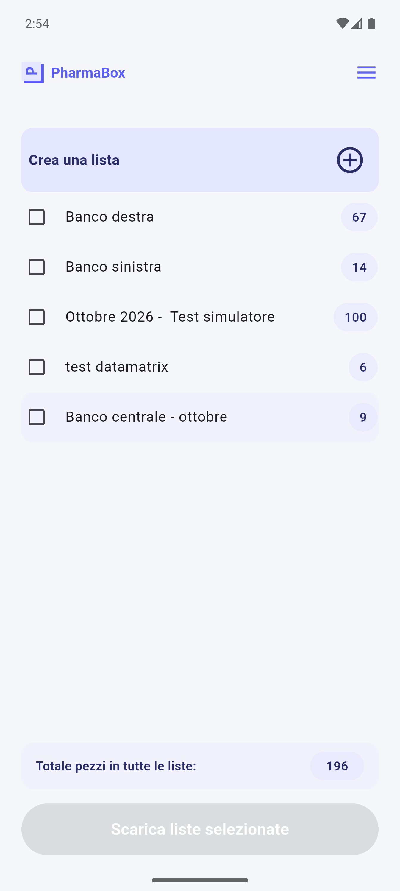

## 6. Creare e rinominare una lista

### Creare una lista

1. Nella schermata principale toccare **+** accanto a **Crea una lista**.
2. Nel campo **Titolo Lista** inserire un nome riconoscibile, per esempio “Magazzino — scaffale 1”.
3. Toccare **Crea**.
4. Toccare il nome della nuova lista per aprirla.

Il nome non può essere vuoto. Se esiste già una lista con lo stesso nome riconosciuto dall’app, viene richiesto di sceglierne un altro. **Chiudi** abbandona la creazione.

Usare nomi che descrivano zona e sessione di lavoro: questo riduce il rischio di scansionare i prodotti nella lista sbagliata. Una lista distinta per ogni zona facilita anche il lavoro su più telefoni.

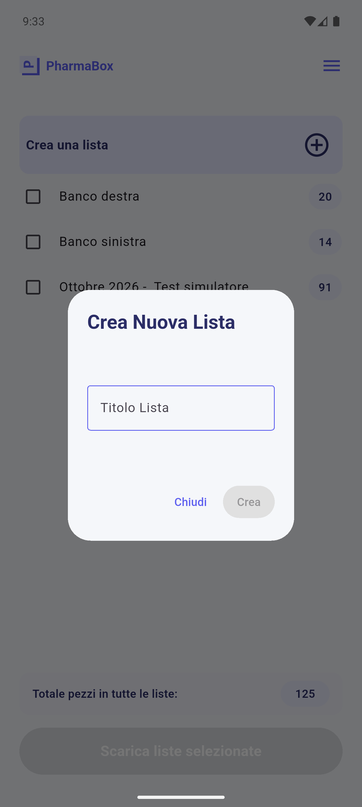

### Rinominare una lista

1. Tornare all’elenco principale.
2. Scorrere sulla riga della lista **da sinistra verso destra**.
3. Nella finestra **Modifica nome lista**, cambiare **Nuovo nome**.
4. Toccare **Salva**. Per mantenere il nome precedente, toccare **Annulla**.

La rinomina conserva prodotti e quantità. Un nome già utilizzato da un’altra lista viene rifiutato.

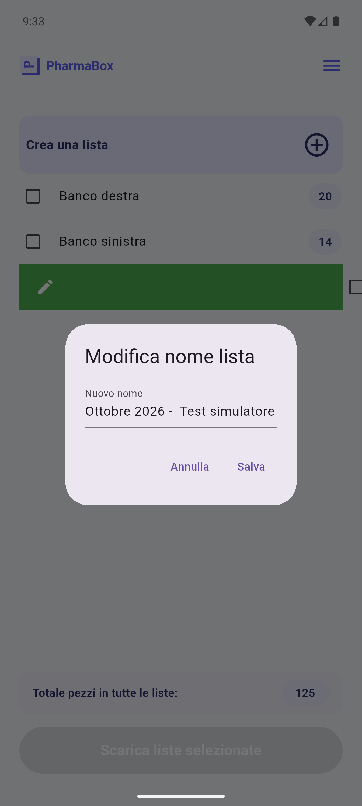

## 7. Cercare e aggiungere prodotti manualmente

Aprire la lista desiderata e scegliere la scheda **Cerca**. Controllare sempre il titolo in alto: gli inserimenti appartengono a quella lista.

1. Toccare il campo di ricerca.
2. Digitare almeno **3 caratteri**: parte del nome, codice EAN oppure codice MINSAN.
3. Toccare **Cerca prodotto**, oppure inviare la ricerca dalla tastiera.
4. Attendere i risultati e scorrere l’elenco, ordinato per nome.
5. Confrontare denominazione, confezione e codice con il prodotto che si sta contando.
6. Toccare **Aggiungi** sulla riga corretta.
7. Passare alla scheda **Lista** per controllare il prodotto e la quantità.

La ricerca manuale mostra i risultati: digitare un codice non equivale da solo a registrare una lettura. Il pulsante **Aggiungi** inserisce un pezzo. Se il prodotto è già nella lista, al posto del pulsante compare il contatore.

Lo stesso nome commerciale può corrispondere a confezioni, dosaggi e codici diversi. Il codice aiuta a scegliere la referenza corretta. Con un MINSAN mantenere anche gli zeri iniziali.

Se il risultato non è quello cercato, modificare il testo e ripetere la ricerca. **Nessun risultato** indica che la ricerca non ha trovato corrispondenze; un’attesa senza risultati può richiedere un controllo della connessione e un nuovo tentativo.

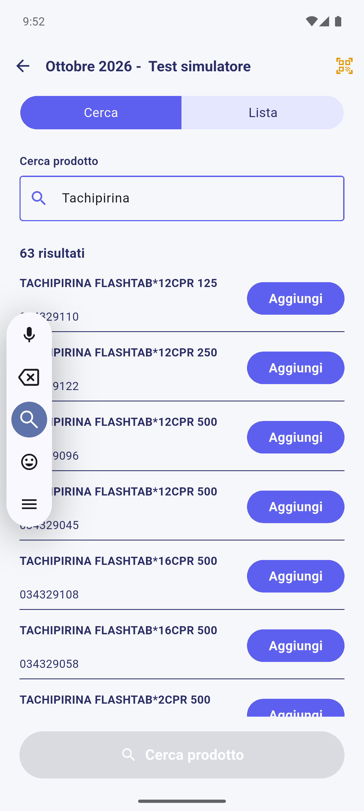

## 8. Aprire la scheda di un prodotto

Toccare il nome del prodotto nei risultati o nella lista. La schermata **Dettaglio** può mostrare immagine, denominazione, codice MINSAN, tipo di prodotto e la sezione **Foglietto illustrativo**.

Scorrere la schermata per leggere i contenuti disponibili. Il foglietto illustrativo occupa un riquadro di altezza fissa: per leggerlo tutto, trascinare il dito **dentro il riquadro**. Le immagini e le informazioni vengono caricate dal servizio: per alcuni prodotti possono mancare. Una descrizione assente non significa che il prodotto non esista nel catalogo.

Se il prodotto non è nella lista, il pulsante **Aggiungi** in basso lo inserisce. Se è già presente, compare il contatore per modificarne i pezzi; per un prodotto con lotti il contatore funziona come nella lista (capitolo 10). Quando si apre il dettaglio dai risultati, l’aggiunta può riportare automaticamente alla ricerca.

### Indicazione “Non vendibile”

Un indicatore rosso **Non vendibile** può comparire nella riga o nel dettaglio. È un segnale da verificare: nella versione descritta può comparire anche se il servizio non riesce a restituire la disponibilità. Non interpretare un errore di caricamento come una conferma definitiva dello stato commerciale; riprovare e verificare il dato tramite i normali strumenti della farmacia.

Il manuale spiega la consultazione della scheda, senza fornire indicazioni terapeutiche.

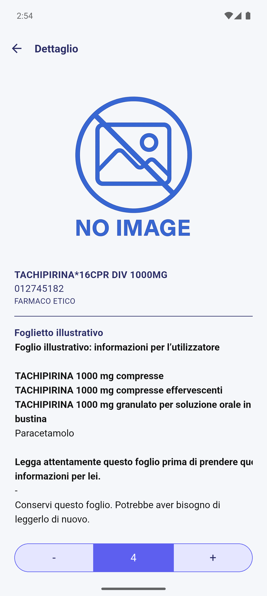

## 9. Collegare e usare lo scanner Bluetooth

### Preparazione

Accendere lo scanner, verificare la batteria e avvicinarlo al telefono. Configurarlo nella modalità Bluetooth compatibile indicata dal produttore. L’app è predisposta per scanner BLE compatibili; un lettore che funziona soltanto come tastiera Bluetooth non è automaticamente equivalente.

Lo scanner esterno richiede l’abilitazione Premium riconosciuta dall’app. Se compare **Attiva PharmaBox Premium**, seguire il capitolo 15. Per individuare un modello compatibile è disponibile **Non hai uno scanner? Scopri quelli compatibili**.

### Connessione

1. Aprire la lista su cui si vuole lavorare e scegliere **Cerca**.
2. Attivare il Bluetooth del telefono.
3. Toccare **Connetti scanner**.
4. Consentire i permessi richiesti dal sistema per cercare e collegare dispositivi vicini. A seconda del sistema può essere richiesto anche l’accesso alla posizione.
5. Nella schermata **Seleziona scanner**, attendere la ricerca dei dispositivi.
6. Toccare il proprio scanner e attendere il messaggio **Scanner collegato!**.

La ricerca privilegia i dispositivi riconosciuti come scanner. **Mostra tutti**, quando disponibile, permette di vedere anche altri dispositivi con nome. Non scegliere un dispositivo soltanto perché compare nell’elenco: confrontarne nome e identificativo con il proprio lettore.

Il telefono ricorda l’ultimo scanner collegato: aprendo una lista prova a ricollegarlo da solo. Se non risponde, compare di nuovo **Connetti scanner**. Il comportamento si cambia in **Opzioni** (capitolo 20).

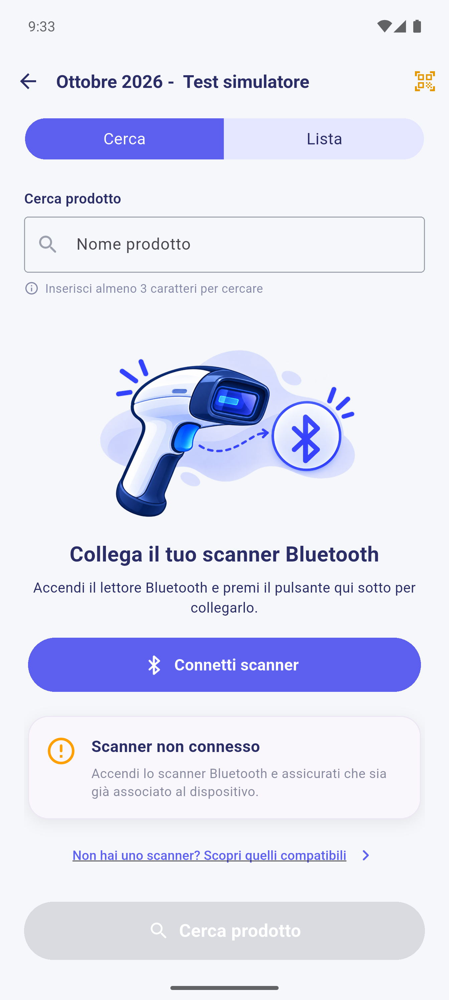

### Se lo scanner non appare

Controllare che sia acceso, vicino e nella modalità corretta. Verificare che non sia già impegnato con un altro telefono. Usare **Cerca di nuovo** al termine della ricerca. Se il Bluetooth è disattivato, abilitarlo nelle impostazioni del telefono o tramite il comando proposto dall’app.

La figura seguente documenta lo stato senza dispositivi individuati nell’emulatore; non rappresenta un collegamento a uno scanner fisico.

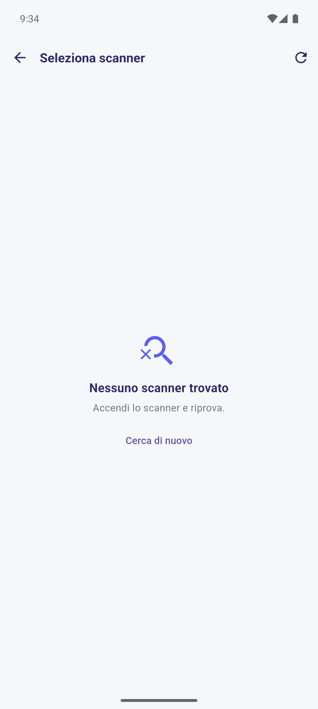

### Contare i prodotti con il lettore

1. Verificare il nome della lista in alto.
2. Passare preferibilmente alla scheda **Lista** per osservare il conteggio.
3. Scansionare una confezione.
4. Verificare che il prodotto sia comparso o che il suo contatore sia aumentato di **1**.
5. Proseguire con le altre confezioni, evitando di leggere due volte la stessa unità fisica.

Una lettura riconosciuta aggiunge un pezzo. Ulteriori letture dello stesso prodotto aumentano la quantità della stessa referenza. Nella scheda **Cerca**, la lettura aggiunge il pezzo e mostra anche i risultati: evitare di premere di nuovo **Aggiungi** per quella stessa confezione.

Letture non riconosciute possono mostrare **Nessun prodotto trovato** o un errore di ricerca. Controllare sempre il contatore: il suono emesso dal lettore, da solo, non conferma che il pezzo sia stato registrato in PharmaBox.

Per interrompere il collegamento utilizzare il comando di disconnessione mostrato quando il lettore è collegato. Un’eventuale ricerca in corso può essere fermata con il comando di arresto.

### Leggere il DataMatrix: scadenza, lotto e seriale

Sulle confezioni dei medicinali il bollino viene progressivamente sostituito dal **DataMatrix**, il quadratino a puntini che contiene codice AIC, scadenza, lotto e numero di serie. Con uno scanner 2D, PharmaBox ne ricava anche **scadenza** e **lotto** e li registra insieme al pezzo. Bollino ed EAN continuano a funzionare come prima, senza dati di scadenza.

Lo scanner va configurato per leggere il DataMatrix e trasmettere il separatore **GS** tra i campi. Se non lo trasmette, l’app può segnalare **Lotto o seriale non leggibili**: in quel caso consultare il manuale dello scanner.

Alla lettura possono comparire questi avvisi:

| Avviso | Significato |
| --- | --- |
| Confezione SCADUTA il … | La confezione è già scaduta. Il pezzo viene comunque contato. |
| Scade il … | La scadenza è entro la soglia arancione (3 mesi, modificabile in Opzioni). |
| Confezione già contata (SN …) | Lo stesso numero di serie è già nella lista: il pezzo **non** viene aggiunto. **Conta di nuovo** lo aggiunge comunque. |
| Lotto o seriale non leggibili | Lo scanner non separa i campi del DataMatrix: va configurato per trasmettere il GS. |

Il numero di serie è diverso per ogni confezione: grazie all’avviso **Confezione già contata**, una confezione letta due volte per errore non viene contata due volte. Gli avvisi di scadenza e di lettura ambigua si possono disattivare in **Opzioni**; quello di confezione già contata è sempre attivo.

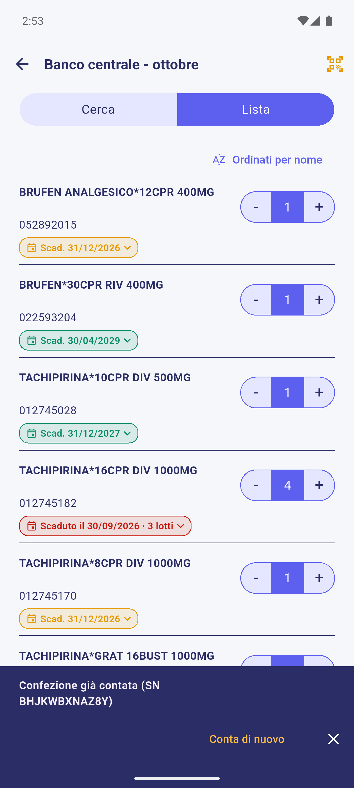

## 10. Consultare la lista e modificare le quantità

La scheda **Lista** mostra i prodotti inseriti, il codice e il contatore. Scorrere per raggiungere le altre righe. Il prodotto identificato dallo stesso MINSAN viene gestito come una sola referenza nella lista.

| Comando | Effetto |
| --- | --- |
| + | Aumenta di un pezzo la quantità del prodotto. |
| − | Riduce di un pezzo la quantità, fino a zero. |
| Numero al centro | Apre Modifica quantità per immettere il totale esatto. |
| Nome del prodotto | Apre il dettaglio. |
| Etichetta della scadenza | Mostra o nasconde, sotto il prodotto, scadenze e lotti. |

Per i prodotti letti dal DataMatrix, **+**, **−** e il numero funzionano in modo diverso: vedere più avanti “Modificare i pezzi di un prodotto con lotti”.

**Esempio:** se risultano 3 pezzi e si contano altre 2 confezioni, premere **+** due volte. Se una verifica fisica stabilisce che il totale corretto è 12, toccare il numero e inserire **12**, non 9.

In alto a destra **Ordinati per nome** / **Ordinati per scadenza** cambia l’ordine dei prodotti; il secondo compare quando almeno un prodotto ha una scadenza. L’ordine con cui si apre la lista si sceglie in **Opzioni**.

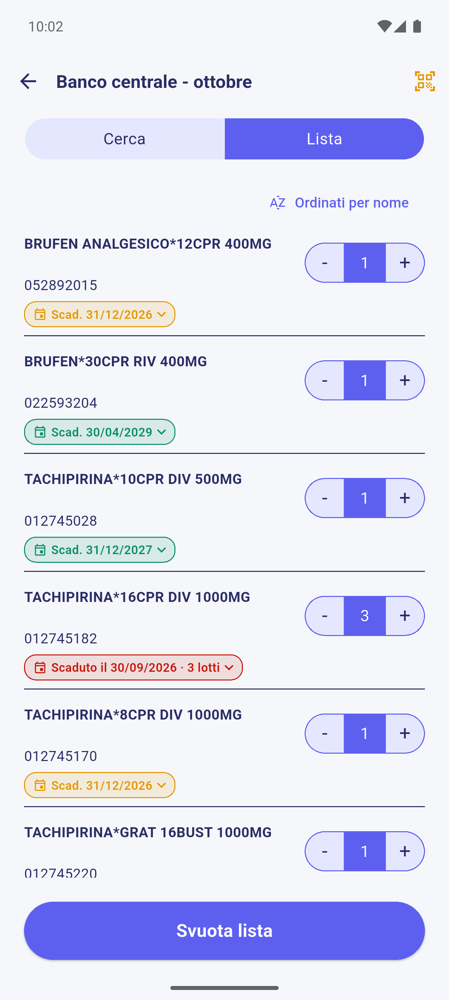

### Scadenze e lotti nella lista

Sotto ogni prodotto letto dal DataMatrix compare un’etichetta con la **scadenza più vicina** e, se sono più d’uno, il numero di lotti. Il colore indica quanto manca:

| Colore | Significato |
| --- | --- |
| Rosso | Scaduto. |
| Arancione | Scade entro 3 mesi (soglia modificabile in Opzioni). |
| Ocra | Scade entro 6 mesi (soglia modificabile in Opzioni). |
| Verde | Scadenza oltre le soglie. |

Toccando l’etichetta si apre, sotto il prodotto, l’elenco delle scadenze: per ognuna il totale e i lotti, poi gli eventuali pezzi **senza scadenza** (letti dal bollino o aggiunti a mano). Toccandola di nuovo l’elenco si chiude.

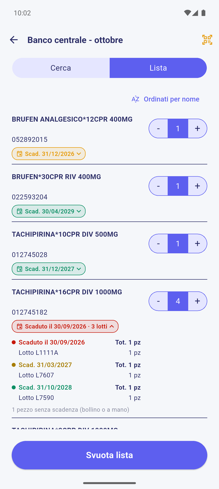

### Modificare i pezzi di un prodotto con lotti

Quando un prodotto ha pezzi letti dal DataMatrix, togliere un pezzo “in generale” non dice da quale lotto. Per questo **+**, **−** e il numero aprono il pannello **Togli o aggiungi pezzi lotto per lotto**:

1. Ogni riga è un lotto, con la sua scadenza colorata; in fondo la riga **Senza scadenza**.
2. Usare **−** o **+** sulla riga del lotto da correggere.
3. Il **Totale** in basso si aggiorna subito.
4. Toccare **Fatto** per chiudere.

Un lotto portato a 0 resta nel pannello finché è aperto, così un pezzo tolto per errore si rimette con **+**. Togliendo un pezzo da un lotto, la confezione corrispondente può essere letta di nuovo senza l’avviso di confezione già contata.

Chi preferisce un **−** immediato può attivare in **Opzioni** la voce **Togli senza scegliere il lotto**: il − toglie subito un pezzo, prima da quelli senza scadenza e poi dal lotto che scade prima, e un messaggio indica da dove è stato tolto. **+** e numero continuano ad aprire il pannello.

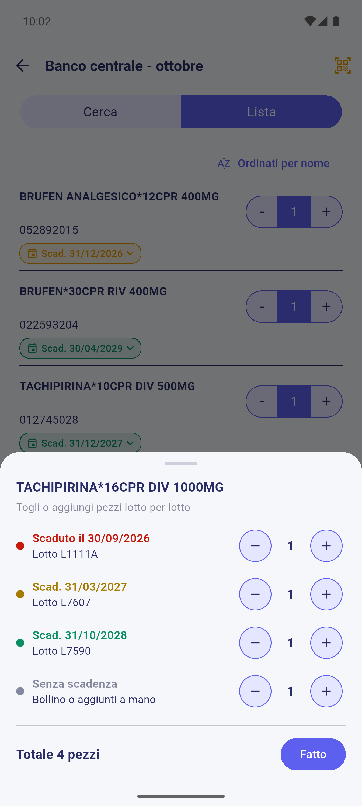

### Inserimento diretto del totale

1. Toccare il numero centrale del contatore.
2. In **Numero pezzi**, sostituire il valore con il totale desiderato.
3. Inserire un numero intero maggiore o uguale a zero.
4. Toccare **Salva** e controllare la riga aggiornata.

**Annulla** conserva il valore precedente. Un valore negativo o non numerico viene rifiutato. Portare la quantità a **0** lascia il prodotto nella lista; per togliere completamente la riga seguire il capitolo 11. Per i prodotti con lotti, il totale si corregge dal pannello dei lotti descritto sopra.

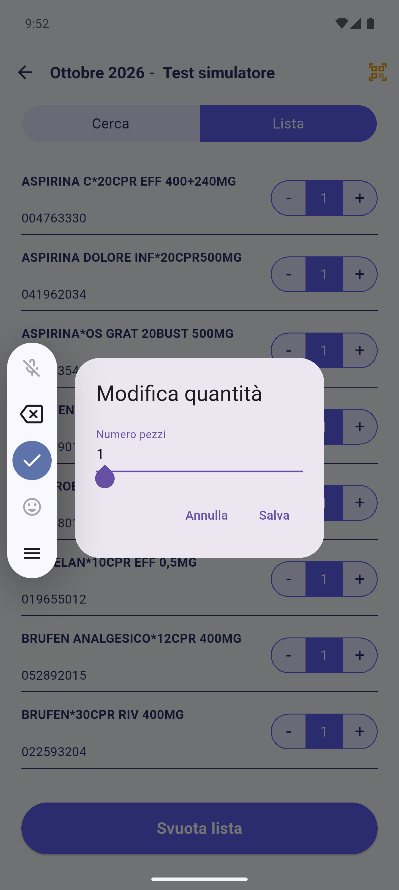

## 11. Rimuovere prodotti, svuotare o eliminare liste

Queste tre operazioni hanno effetti diversi. Prima di confermare, verificare il titolo della finestra e il nome dell’elemento interessato. Se occorre conservarne una copia, esportare prima i dati.

| Operazione | Come avviarla | Risultato |
| --- | --- | --- |
| Eliminare un prodotto | Nella scheda Lista, scorrere la sua riga da destra verso sinistra. | Rimuove quella referenza e i suoi pezzi dalla lista. |
| Svuotare una lista | Aprire la lista e toccare Svuota lista. | Rimuove tutti i prodotti, mantenendo la lista e il suo nome. |
| Eliminare una lista | Nell’elenco principale, scorrere la riga da destra verso sinistra. | Elimina la lista e i prodotti che contiene. |

### Confermare o annullare

Per rimuovere un prodotto o una lista, leggere **Conferma eliminazione** e scegliere **Elimina**. Per cancellare tutti i prodotti della lista aperta, leggere **Conferma svuotamento** e scegliere **Svuota**. **Annulla** interrompe l’operazione.

Non confondere i due gesti nell’elenco principale: **verso destra si rinomina**, **verso sinistra si elimina**. Non è presente un cestino utente da cui recuperare gli elementi eliminati.

L’eliminazione modifica le liste condivise dall’account e può quindi essere vista anche sugli altri telefoni collegati.

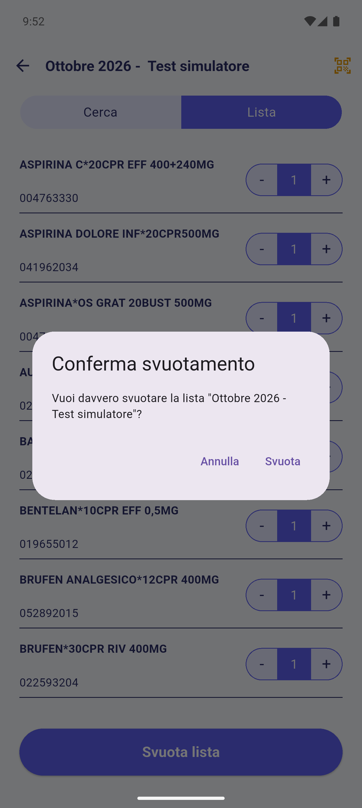

## 12. Salvataggio, sincronizzazione e più telefoni

Non è presente un pulsante generale “Salva inventario”: gli inserimenti e le modifiche vengono salvati automaticamente. Quando i telefoni accedono allo **stesso account**, le liste e le quantità vengono sincronizzate.

Per lavorare in gruppo, assegnare una zona fisica a ciascun operatore e concordare le liste da utilizzare. La sincronizzazione somma le letture registrate; non riconosce se due persone stanno contando la stessa confezione fisica.

### Scansioni contemporanee e correzioni manuali

Le letture aggiungono pezzi e possono essere eseguite da più telefoni. L’inserimento manuale di una quantità, invece, imposta un totale esatto: evitare che più operatori correggano contemporaneamente lo stesso prodotto. Durante una rettifica concordare chi esegue il controllo e attendere l’aggiornamento sugli altri dispositivi.

### Se manca Internet

Le modifiche a dati già disponibili possono essere conservate localmente e inviate al ritorno della rete. Questo non rende tutte le funzioni utilizzabili offline: la ricerca di prodotti, il caricamento delle schede, l’accesso e la verifica dell’abbonamento dipendono dai rispettivi servizi.

Una modifica subito visibile sul proprio telefono non prova che sia già arrivata agli altri dispositivi. Al ritorno della connessione, riaprire la lista e confrontare quantità e totale prima dell’esportazione finale. L’app non presenta in queste schermate un indicatore dettagliato di tutte le scritture in attesa.

Se una lista non compare su un altro telefono, verificare prima account, connessione e nome della lista. **Ripristina Acquisti** riguarda l’abbonamento e non recupera liste eliminate.

## 13. Esportare in PDF o CSV

### Selezionare le liste

1. Tornare alla schermata principale.
2. Spuntare la casella a sinistra di ogni lista da includere.
3. Toccare **Scarica liste selezionate**.
4. Scegliere **Scarica PDF** oppure **Scarica CSV**.

La selezione delle caselle è destinata all’esportazione: il totale generale in basso continua a riferirsi a tutte le liste. Se le liste selezionate sono tutte vuote, l’app segnala che non contengono prodotti.

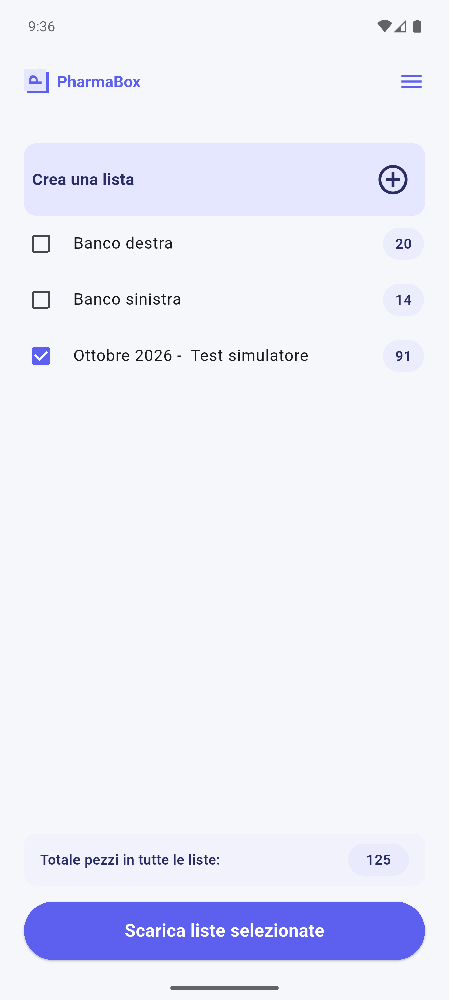

### Scegliere il formato

| Formato | Quando usarlo | Contenuto |
| --- | --- | --- |
| PDF | Consultazione, stampa e invio di un prospetto leggibile. | Data, nome farmacia se inserito, sezioni per lista, prodotti, MINSAN, pezzi, scadenza più vicina e totale di ciascuna lista. |
| CSV | Elaborazione in un foglio di calcolo o in un sistema che accetta questo formato. | Colonne Lista, Nome prodotto, Minsan, Pezzi, Scadenza; riga di totale per lista. |

La colonna **Scadenza** riporta la scadenza più vicina del prodotto ed è vuota per i prodotti senza DataMatrix. L’esportazione rappresenta i dati letti quando viene preparata. Se l’inventario continua a cambiare, generare un nuovo file dopo la conclusione del conteggio.

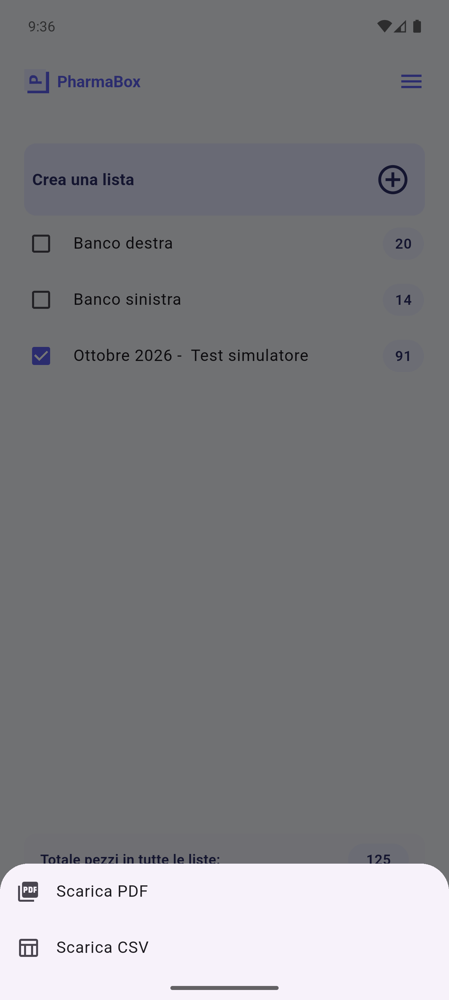

### Nome del file e nome farmacia

1. Nel dialogo **Nome del file**, mantenere la data proposta o scrivere un nome riconoscibile, per esempio `Inventario-ottobre-2026`.
2. Compilare **Nome farmacia (facoltativo)** se si vuole includerlo nel documento.
3. Toccare **Continua** e attendere la preparazione.

L’estensione viene gestita dall’app. Evitare caratteri come `/`, `\`, `:`, `*`, `?`, virgolette e barre verticali: un nome non valido viene segnalato prima di procedere. **Annulla** chiude la finestra senza generare il documento.

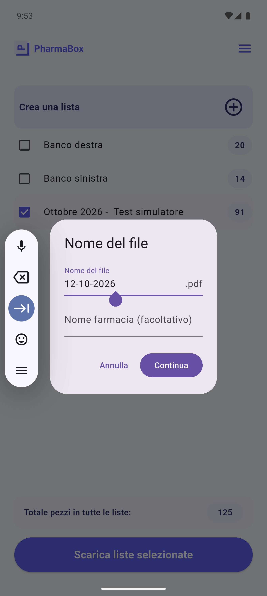

### Salvare o condividere il documento

Una volta pronto, si apre il pannello di condivisione del telefono. Scegliere una destinazione disponibile: un servizio di archiviazione, un’app email, una funzione di stampa o un’altra applicazione compatibile. Completare il salvataggio o l’invio nell’app scelta.

La presenza del pannello non significa che il documento sia già stato inviato o archiviato nella cartella Download. Chiudendolo si annulla la condivisione. Per ripetere l’operazione, esportare di nuovo le liste.

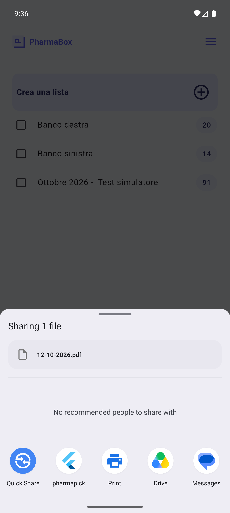

### Aprire correttamente il CSV

Il file usa il **punto e virgola** come separatore ed è codificato in **UTF-8**. Se il foglio di calcolo mostra tutto in una sola colonna, usare l’importazione da testo/CSV e scegliere il separatore corretto.

Importare la colonna **Minsan come testo**: altrimenti il foglio di calcolo può eliminare gli zeri iniziali. Una riga con un nome farmacia può precedere l’intestazione. Le righe **Totale pezzi** sono riepiloghi: non sommarle una seconda volta insieme alle righe dei prodotti.

PharmaBox, nella versione descritta, non offre un comando utente per reimportare questi file e ricostruire automaticamente le liste.

## 14. Esercitazione: un inventario dall’inizio alla fine

Questa procedura combina tutte le operazioni ordinarie. Usare una lista dedicata alla prova e una zona fisica delimitata.

1. Accedere e creare la lista **Prova inventario — scaffale 1**.
2. Aprire la lista e verificarne il titolo.
3. Cercare manualmente una confezione effettivamente presente, controllando nome e codice.
4. Premere **Aggiungi** e verificare un pezzo nella scheda **Lista**.
5. Contare le confezioni dello stesso prodotto e correggere il totale con il contatore.
6. Se si dispone di Premium e di uno scanner compatibile, collegarlo dalla scheda **Cerca**.
7. Tornare a **Lista**, leggere una confezione diversa e verificare l’incremento.
8. Continuare con i prodotti della zona assegnata. Non sommare una scansione a una quantità già conteggiata per la stessa confezione.
9. Rivedere ogni quantità; correggere eventuali doppie letture con **−** o con **Modifica quantità** (per i prodotti con lotti, dal pannello dei lotti). Controllare le etichette rosse e arancioni delle scadenze.
10. Attendere la sincronizzazione, se si lavora su più dispositivi.
11. Tornare alla home, selezionare la lista e creare un **PDF**.
12. Salvare il documento nella destinazione scelta e aprirlo per controllare titolo, prodotti, codici e totale.
13. Se serve un’elaborazione successiva, ripetere l’esportazione in **CSV**.

### Controllo di fine inventario

- Tutte le zone previste sono state contate una sola volta.
- I prodotti con confezioni simili sono stati distinti tramite il codice.
- Quantità anomale e letture duplicate sono state controllate.
- I telefoni condividono lo stesso risultato dopo la sincronizzazione.
- Il file esportato si apre e corrisponde al conteggio finale.

Conservare il PDF o il CSV prima di svuotare o eliminare la lista di lavoro.

## 15. Abbonamento Premium e scanner

Dal menu principale aprire **Abbonamento & Scanner**. La voce **Stato abbonamento** mostra **Attivo** o **Non attivo** secondo i dati dell’account. La stessa schermata contiene **Acquista uno scanner** e **Come annullare l’abbonamento**.

L’abbonamento è legato all’**account PharmaBox**: accedendo con lo stesso account è riconosciuto su tutti i telefoni, anche tra Android e iPhone, e non passa a un altro account che usi lo stesso telefono. Il flusso Premium abilita il collegamento dello scanner compatibile. Le condizioni e le offerte effettivamente disponibili vanno lette nella schermata di acquisto e nella conferma dello store. Il manuale non fissa un prezzo né promette una durata promozionale.

### Attivazione

1. Dalla lista toccare **Attiva PharmaBox Premium**, se proposto, oppure aprire lo stato non attivo dal menu.
2. Attendere il caricamento delle offerte disponibili.
3. Leggere prezzo, periodo e condizioni del piano visualizzato.
4. Scegliere l’offerta e completare l’acquisto nella finestra dello store.
5. Tornare a PharmaBox, attendere l’aggiornamento dello stato e riprovare il collegamento dello scanner.

Un acquisto annullato o non completato non attiva l’abbonamento. Se le offerte non si caricano, verificare connessione e account dello store, poi riprovare su un dispositivo supportato. Se si è già acquistato, usare prima il ripristino descritto nel capitolo 16.

Il collegamento **Acquista uno scanner** apre una pagina esterna: l’acquisto dell’hardware è un’operazione distinta dall’abbonamento. Controllare la compatibilità del modello prima dell’acquisto.

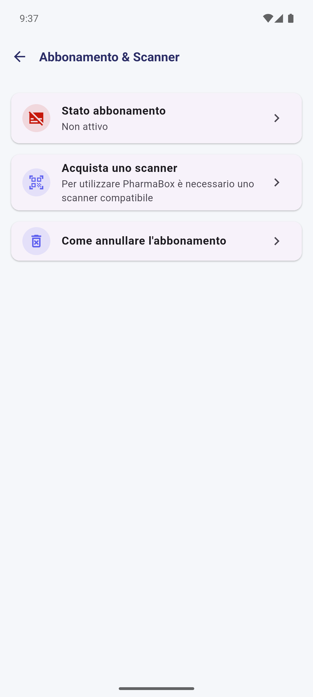

## 16. Ripristinare acquisti e gestire il rinnovo

### Ripristino

Di norma il ripristino non serve: l’abbonamento si ritrova accedendo con lo stesso account PharmaBox. Usarlo quando un acquisto precedente non viene riconosciuto, per esempio un acquisto fatto con una versione meno recente dell’app. Accedere al corretto account PharmaBox e, se richiesto, all’account dello store usato per l’acquisto.

1. Aprire il menu della schermata principale.
2. Toccare **Ripristina**.
3. Nella pagina **Ripristina Acquisti**, premere il pulsante omonimo.
4. Attendere l’esito. Se vengono ripristinati acquisti, tornare all’abbonamento e verificarne lo stato.

Se appare **Nessun abbonamento attivo trovato**, controllare account dello store, validità dell’acquisto e connessione. Il ripristino non garantisce trasferimenti tra store diversi e non è un recupero dei dati di inventario.

### Annullare il rinnovo

La voce **Come annullare l’abbonamento** fornisce indicazioni, ma il rinnovo va gestito nello store che fattura l’acquisto. Le schermate dello store possono evolvere.

**Android:** aprire la sezione degli abbonamenti di Google Play con l’account corretto, selezionare PharmaBox, scegliere **Annulla abbonamento** e completare la procedura. Disinstallare l’app non annulla l’abbonamento. In generale, il periodo già pagato resta utilizzabile secondo le condizioni del piano. [Guida ufficiale Google Play](https://support.google.com/googleplay/answer/7018481?hl=it).

**iPhone:** aprire **Impostazioni**, toccare il proprio nome, entrare in **Abbonamenti**, scegliere PharmaBox e usare **Annulla abbonamento**. Se non compare il comando e viene indicata una scadenza, controllare se il rinnovo è già stato annullato. [Guida ufficiale Apple](https://support.apple.com/it-it/118428).

Verificare sempre l’esito nello store. Logout, rimozione di una lista e cancellazione dell’account PharmaBox non sostituiscono questa operazione.

## 17. Gestire email, password e account

Dal menu aprire **Info**: la pagina **Informazioni** contiene i comandi dell’account autenticato.

### Cambiare password

Toccare **Cambia password**, controllare l’email associata all’account e seguire il messaggio di reimpostazione ricevuto. La nuova password viene scelta tramite il collegamento nell’email, non direttamente in questa pagina. Al successivo accesso aggiornare anche un’eventuale password riproposta nei campi memorizzati.

### Cambiare email

1. Toccare **Cambia email**.
2. Inserire il nuovo indirizzo nella finestra e controllarlo con attenzione.
3. Toccare **Conferma**.
4. Se richiesto, reinserire la password per confermare l’identità.
5. Seguire la verifica inviata al nuovo indirizzo e le indicazioni mostrate nell’app.

Un indirizzo non valido o già associato a un altro account viene rifiutato. Scrivere il nuovo indirizzo nel campo e chiudere con **Annulla** non modifica l’account.

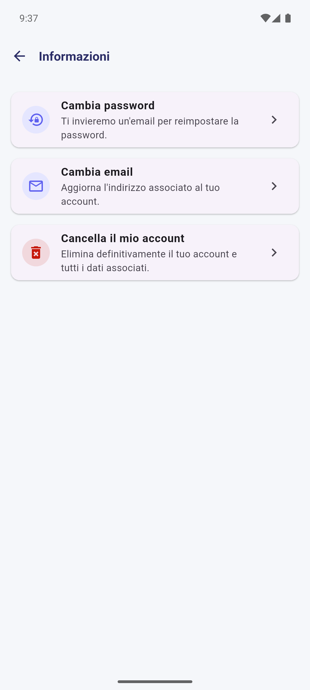

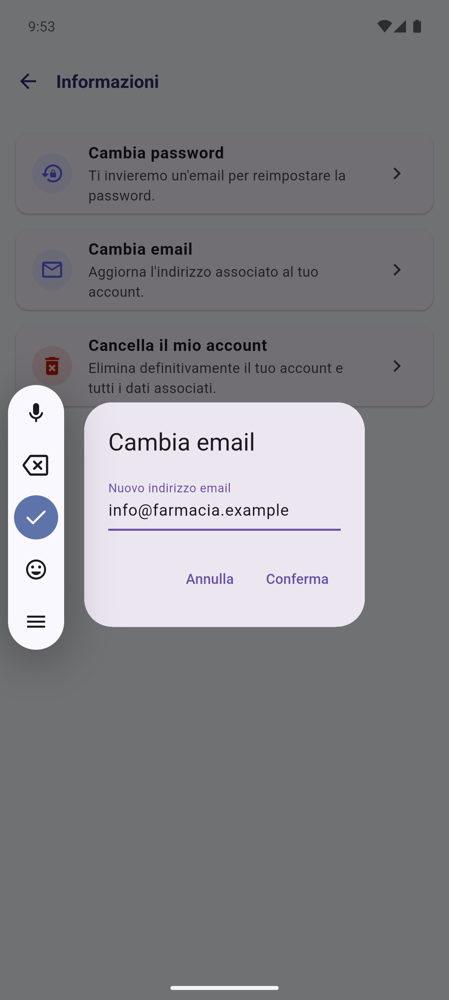

### Cancellare l’account

La voce **Cancella il mio account** apre una richiesta di conferma definitiva. Prima di procedere, esportare le liste che si desidera conservare e gestire separatamente gli eventuali rinnovi nello store.

Toccare **Conferma** soltanto quando si intende cancellare l’account. Se viene richiesto un accesso recente, eseguire nuovamente il login e ripetere l’operazione. **Annulla** mantiene l’account. Non usare questa funzione per correggere una lista o per risolvere un problema di password.

## 18. Uscire dall’account e cambiare telefono

Per uscire, aprire il menu principale, toccare **Log out** e poi **Logout** nella finestra **Conferma logout**. **Annulla** mantiene la sessione.

Il logout non elimina le liste. Per ritrovarle su un altro telefono, installare l’app ed effettuare l’accesso con lo stesso account, con una connessione disponibile: anche l’abbonamento viene riconosciuto. Se non lo è, usare **Ripristina** (capitolo 16). Le **Opzioni** invece sono legate al telefono e vanno reimpostate sul nuovo dispositivo.

Le credenziali eventualmente ricordate possono restare nei campi di accesso dopo il logout: controllarle prima di consegnare un telefono a un’altra persona. L’opzione **Ricorda credenziali** viene aggiornata al successivo accesso completato.

Prima di disinstallare l’app o cambiare telefono, attendere che le modifiche siano sincronizzate e conservare un’esportazione finale. Evitare di usare la reinstallazione come primo tentativo per risolvere una ricerca non riuscita.

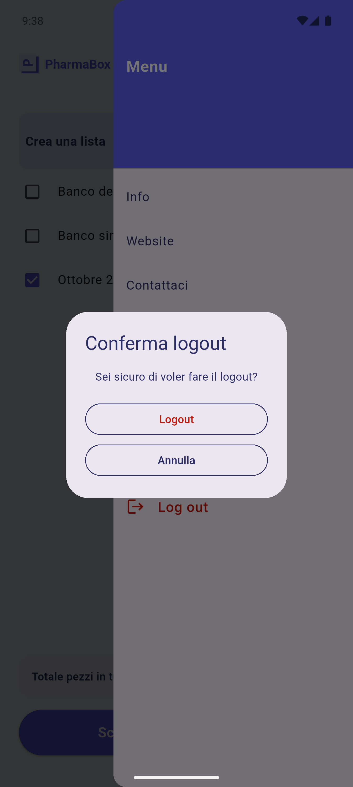

## 19. Menu, assistenza e documenti

Aprire il menu in alto a destra dalla schermata principale.

| Voce | Utilizzo |
| --- | --- |
| Info | Gestione di password, email e account. |
| Opzioni | Preferenze di questo telefono: ordinamento, scanner, suoni, avvisi, scadenze (capitolo 20). |
| Website | Apertura del sito associato all’app. |
| Contattaci | Preparazione di una richiesta nell’app email del telefono. |
| Abbonamento & Scanner | Stato del piano e collegamenti per scanner e rinnovo. |
| Ripristina | Recupero degli acquisti riconoscibili dallo store. |
| Privacy Policy | Consultazione dell’informativa accessibile dall’app. |
| Termini di Utilizzo | Consultazione dei termini presentati dall’app. |
| Log out | Uscita dalla sessione, dopo conferma. |

Per assistenza, l’indirizzo indicato dall’app è **infopharmabox@doublecore.it**. Se **Contattaci** non apre un programma email, usare direttamente quell’indirizzo nel proprio servizio di posta. Il messaggio deve essere inviato dall’utente dopo averne controllato il contenuto.

Per una segnalazione utile, indicare modello del telefono, versione dell’app, passaggi eseguiti, messaggio esatto e, se pertinente, codice del prodotto o modello dello scanner. Allegare uno screenshot pertinente evitando password e informazioni non necessarie.

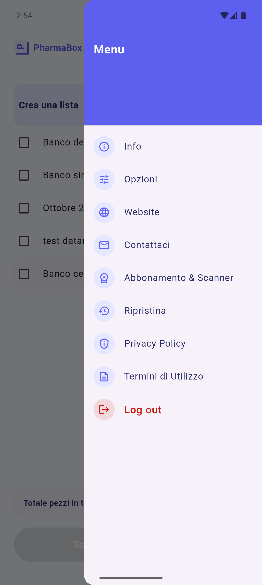

## 20. Opzioni del telefono

Dal menu aprire **Opzioni**. Le impostazioni valgono **solo per questo telefono**, qualunque account sia collegato, e restano anche dopo il logout. Si applicano subito, senza un pulsante di salvataggio.

| Sezione | Opzione | Effetto |
| --- | --- | --- |
| Lista | Ordinamento della lista | Ordine con cui si apre la lista: per nome, per scadenza o l’ultimo usato. |
| Scanner | Ricollega l’ultimo scanner | Aprendo una lista, ricollega da solo l’ultimo scanner usato; mostra lo scanner salvato e permette di dimenticarlo. |
| Lettura | Feedback aptico | Vibrazione quando si modificano i pezzi e agli avvisi. |
| Lettura | Suono alla lettura | Un bip a ogni lettura e un suono diverso per gli avvisi; non suona con il telefono in silenzioso. |
| Avvisi alla lettura | Scaduta, in scadenza, ambigua | Attivano o disattivano i singoli avvisi; “già contata” è sempre attivo. |
| Scadenze | Arancione e ocra | Soglie in mesi per i colori delle scadenze e per l’avviso in scadenza. |
| Inventario | Schermo sempre acceso | Con una lista aperta il telefono non va in standby. |
| Inventario | Scadenze e lotti sempre aperti | Mostra sempre, sotto ogni prodotto, l’elenco delle scadenze. |
| Inventario | Togli senza scegliere il lotto | Il − toglie subito un pezzo senza aprire il pannello dei lotti (capitolo 10). |

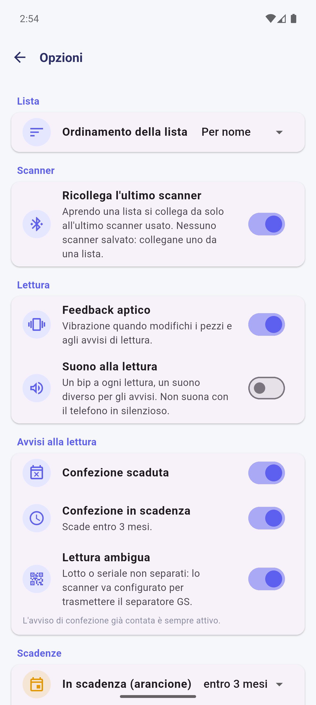

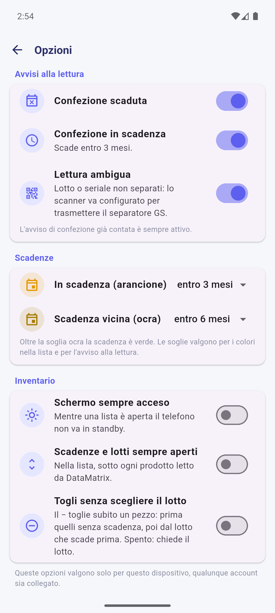

## 21. Buone pratiche quotidiane

### Prima di iniziare

Verificare account, connessione, batteria del telefono e dello scanner. Aprire la lista corretta e fare una lettura di controllo. Se più persone lavorano insieme, assegnare zone che non si sovrappongano.

### Durante il conteggio

Distinguere sempre referenza e pezzi. Controllare il codice per confezioni simili. Osservare l’aggiornamento del contatore dopo una scansione. Correggere subito le letture doppie e annotare i prodotti per i quali la ricerca non riesce, così da completarli in un secondo momento.

Non eseguire simultaneamente correzioni manuali del totale sullo stesso prodotto da più telefoni. Se si inserisce direttamente un totale, si deve conoscere il conteggio complessivo corretto, non soltanto i pezzi appena trovati.

### Alla chiusura

Rivedere le quantità, aspettare l’allineamento tra i dispositivi e generare il documento finale. Aprire il file salvato per verificarlo. Solo dopo decidere se conservare, rinominare, svuotare o eliminare le liste di lavoro.

Usare un nome del file che indichi almeno periodo e zona o sessione. In un foglio di calcolo, mantenere i MINSAN come testo e distinguere le righe prodotto dai totali.

## 22. Problemi frequenti e soluzioni

### Accesso e registrazione

| Problema | Che cosa controllare |
| --- | --- |
| Crea account non è attivo | Requisiti della password e coincidenza della conferma. |
| Email già registrata | Usare Accedi o Password dimenticata, senza creare un duplicato. |
| Email non verificata | Aprire il collegamento ricevuto; controllare spam e riprovare l’accesso. |
| Password errata o errore di autenticazione | Indirizzo esatto, password attuale, connessione e recupero password. |
| Troppe richieste | Attendere prima di ripetere accesso o invio email. |
| Il recupero non arriva | Email corretta, spam e tempi di consegna. Il messaggio dell’app non prova che l’account esista. |

### Liste e prodotti

| Problema | Che cosa fare |
| --- | --- |
| Lista apparentemente scomparsa | Controllare account e connessione; verificare se un altro operatore l’ha rinominata o eliminata. |
| Esiste già una lista con questo nome | Scegliere un nome distinto o aprire la lista esistente. |
| Cerca prodotto disabilitato | Digitare almeno 3 caratteri; modificare la ricerca se è identica a quella già effettuata. |
| Nessun risultato | Controllare codice, zeri iniziali e nome; provare una parte più breve del nome. |
| Il prodotto non compare nella lista | La ricerca manuale richiede Aggiungi; verificare il titolo della lista e il risultato del salvataggio. |
| Quantità troppo alta | Verificare doppie letture, aggiunte manuali e conteggi di altri operatori; correggere il totale. |
| Riga rimasta con zero pezzi | È il comportamento previsto; usare l’eliminazione esplicita per rimuoverla. |
| Il − apre un pannello invece di togliere un pezzo | Il prodotto ha lotti: scegliere il lotto, oppure attivare in Opzioni “Togli senza scegliere il lotto”. |
| Non vendibile o descrizione assente | Riprovare con connessione disponibile e verificare il dato; il servizio può essere indisponibile. |
| Un altro telefono mostra dati diversi | Verificare stesso account e stessa lista; attendere la sincronizzazione con rete disponibile. |

### Scanner e abbonamento

| Problema | Che cosa fare |
| --- | --- |
| Nessuno scanner trovato | Accensione, carica, vicinanza, modalità compatibile; poi Cerca di nuovo. |
| Bluetooth disattivato | Attivarlo sul telefono e concedere i permessi necessari. |
| Il dispositivo appare ma non si collega | Verificare che sia il lettore corretto, non sia impegnato con un altro telefono e supporti la modalità richiesta. |
| Il lettore suona ma i pezzi non aumentano | Controllare connessione nell’app, lista aperta, riconoscimento del codice e rete. |
| Confezione già contata | Lo stesso numero di serie è già in lista. Usare Conta di nuovo solo se è davvero un’altra confezione. |
| Lotto o seriale non leggibili | Configurare lo scanner per trasmettere il separatore GS del DataMatrix. |
| Il DataMatrix non viene letto | Serve uno scanner 2D con la lettura DataMatrix attiva; i lettori laser leggono solo bollino ed EAN. |
| Abbonamento non riconosciuto su un altro telefono | Accedere con lo stesso account PharmaBox; se non basta, usare Ripristina. |
| Account non attivo | Controllare Premium e, se già acquistato, usare il ripristino con lo store corretto. |
| Nessuna offerta disponibile | Verificare rete e disponibilità degli acquisti sul dispositivo; contattare assistenza se persiste. |
| Ripristino senza abbonamento attivo | Verificare account dello store e validità dell’acquisto; non acquistare di nuovo senza aver controllato. |

### Esportazione e consultazione

| Problema | Che cosa fare |
| --- | --- |
| Scarica liste selezionate è grigio | Spuntare almeno una lista. |
| Le liste selezionate non contengono prodotti | Aggiungere prodotti o scegliere una lista già popolata. |
| Nome file non valido | Usare lettere, numeri, spazi o trattini; eliminare caratteri vietati. |
| File non trovato dopo l’esportazione | Completare il salvataggio nel pannello di condivisione; non presumere la cartella Download. |
| CSV tutto in una colonna | Importare come UTF-8 con separatore punto e virgola. |
| MINSAN senza zeri iniziali | Reimportare la colonna come testo dal CSV originale. |
| Totale raddoppiato nel foglio di calcolo | Escludere le righe Totale pezzi dalla somma dei prodotti. |
| Il foglietto si legge solo in parte | Trascinare il dito dentro il riquadro del foglietto; se resta vuoto, riprovare con la connessione e segnalare il prodotto. |

Se il problema persiste, raccogliere i dettagli del capitolo 19. Evitare di cancellare l’account o le liste come tentativo generico di riparazione.

## 23. Glossario e comandi rapidi

| Termine | Significato |
| --- | --- |
| Account PharmaBox | Identità di accesso a cui appartengono le liste. |
| Account dello store | Account Google o Apple che gestisce l’acquisto. Può essere distinto dall’email PharmaBox. |
| MINSAN | Codice identificativo del prodotto, normalmente di 9 cifre nei casi mostrati. Conservare gli zeri iniziali. |
| EAN | Codice a barre usato come chiave di ricerca per i prodotti riconosciuti. |
| DataMatrix | Codice 2D sulle confezioni dei medicinali con AIC, scadenza, lotto e numero di serie. Richiede uno scanner 2D. |
| Lotto | Partita di produzione indicata sulla confezione; pezzi dello stesso prodotto possono avere lotti e scadenze diversi. |
| Numero di serie (SN) | Codice unico di ogni confezione: permette di riconoscere una confezione già contata. |
| BLE | Bluetooth Low Energy, tecnologia usata dai lettori compatibili con questo flusso dell’app. |
| Referenza | Uno specifico prodotto/confezione distinto dagli altri tramite il codice. |
| Sincronizzazione | Aggiornamento delle liste tra i dispositivi dello stesso account. |
| PDF | Documento pronto per lettura e stampa. |
| CSV | File di testo tabellare per elaborazioni successive. |
| Ripristino acquisti | Verifica degli acquisti precedenti; non è il recupero di liste eliminate. |

### Promemoria dei gesti

| Dove | Gesto | Azione |
| --- | --- | --- |
| Home | Toccare + | Creare una lista. |
| Home | Toccare il nome | Aprire la lista. |
| Home | Spuntare la casella | Selezionare per esportazione. |
| Home | Riga verso destra | Rinominare la lista. |
| Home | Riga verso sinistra | Richiedere l’eliminazione della lista. |
| Lista | Toccare + o − | Correggere di un pezzo; con lotti apre il pannello dei lotti. |
| Lista | Toccare l’etichetta di scadenza | Mostrare o nascondere scadenze e lotti. |
| Lista | Toccare il numero | Impostare il totale esatto. |
| Lista | Riga verso sinistra | Richiedere la rimozione del prodotto. |
| Lista | Svuota lista | Richiedere la rimozione di tutti i prodotti. |

## 24. Appendice: ambiente di prova e limiti della verifica

Il manuale descrive il codice della versione **1.0.4+34**, sul ramo **datamatrix-scadenze**, riferimento **2d24a19**, e le schermate dell’app installata sull’emulatore Android disponibile durante il lavoro. La prima acquisizione è del **12 ottobre 2026**; le schermate di liste, scadenze e lotti, dettaglio, menu e opzioni sono state aggiornate il **15 ottobre 2026**. Non è stato eseguito un collaudo su iPhone o con uno scanner fisico.

Sono state percorse nell’app le schermate di accesso, registrazione, recupero password, liste, creazione e rinomina, ricerca, dettaglio, modifica quantità, conferma di svuotamento, selettore scanner, esportazione PDF, condivisione, menu, account, abbonamento, ripristino e logout. Le operazioni che inviano email, acquistano, ripristinano realmente un acquisto o cancellano dati non sono state confermate per produrre le immagini.

La creazione del PDF è stata verificata fino al pannello di condivisione, senza inviarlo a destinatari. Il formato CSV è descritto sulla base del codice di esportazione. Le procedure di annullamento del rinnovo sono state confrontate con le guide ufficiali Apple e Google indicate nel capitolo 16.

Le letture DataMatrix illustrate sono state prodotte con il simulatore integrato, che segue lo stesso percorso di una lettura Bluetooth; la lettura con uno scanner 2D reale va ancora verificata. Il foglietto illustrativo ora scorre nel proprio riquadro e non provoca più l’arresto osservato nella prima edizione. Anche la connessione BLE e il completamento degli acquisti richiedono una verifica su dispositivo adatto.

### Simulatore nelle build di sviluppo

L’icona arancione visibile in alto nella lista apre **Simula lettura Bluetooth**. È uno strumento di prova, assente nella build di rilascio, e non attiva la fotocamera.

Consente di inserire codici, ripetizioni e ritardo. **Inserisci 30 MINSAN di esempio** compila una sequenza pronta; **Inserisci DataMatrix di esempio** aggiunge confezioni con scadenze diverse; **Componi DataMatrix…** crea una confezione scegliendo prodotto, scadenza, lotto e seriale; **Simula** la invia e il comando di arresto interrompe la raffica. Una sequenza di 30 codici ripetuta due volte produce 60 eventi di lettura.

Il simulatore usa il normale flusso dell’app e può modificare le quantità della lista aperta. Se lo si usa per formazione o sviluppo, scegliere una lista dedicata. Non serve per l’utilizzo quotidiano descritto nei capitoli precedenti.
